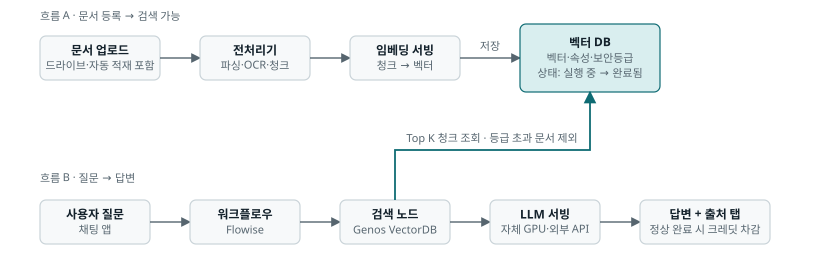
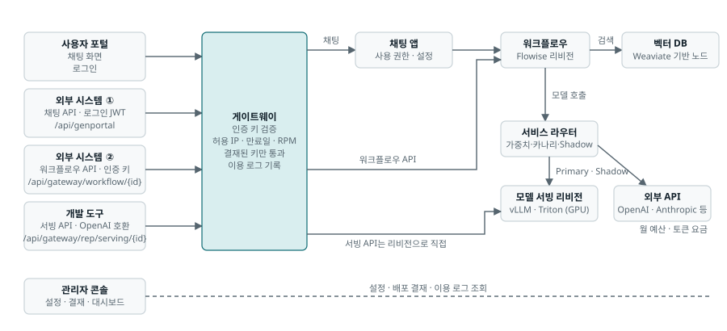
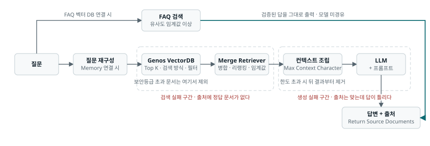
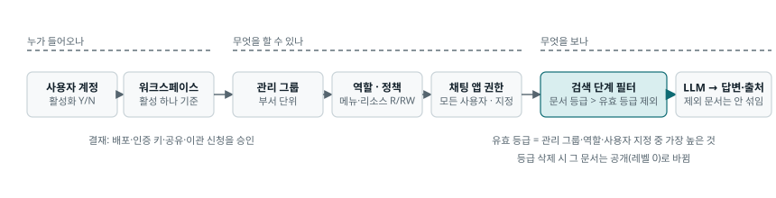
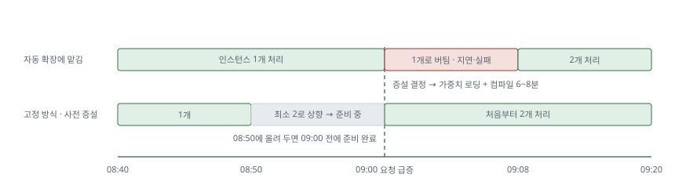

# GenOS PM 학습 노트

GenOS 도입·제안을 맡은 PM을 위한 10회차 학습 노트입니다. 정적 HTML 한 장(`index.html`)으로 동작합니다.

- 근거: [GenOS 공식 문서](https://genos-docs.gitbook.io/default) v1.9.6 (확인일 2026-10-30)과 실제 환경 읽기 전용 점검(v1.9.6, 2026-11-03). 각 주장에 **확인 / 원리 / 추정 / 확인 필요 / 실환경** 표시를 붙였습니다.
- 회차마다 쉬운 설명, 다이어그램, 자사 플랫폼 적용, 10분 직접 확인 과제, PM 판단, 실무 사례, 이해도 질문, 용어, 근거 문서 링크가 있습니다.
- 답안·메모·체크 상태는 방문한 브라우저의 localStorage에만 저장됩니다(기기 간 동기화 없음).
- 외부 요청은 Google Fonts와 GenOS 공식 문서 링크뿐입니다.

## 구성

| 경로 | 내용 |
|---|---|
| `index.html` | 학습 페이지 (1~10회차 전체) |
| `diagrams/*.svg` | 회차별 다이어그램 14개. 페이지에 인라인으로 들어 있고, 문서·슬라이드에 그대로 쓸 수 있게 따로 두었습니다 |
| `docs/GenOS_학습노트.md` | 플랫폼 한 장 요약, 버전별 문서 변화, 확인 질문 목록, 용어집, 검수 예시 |

## 회차

| 회차 | 주제 | 다이어그램 |
|---|---|---|
| 1 | 제품 목적과 기능 지도 | 두 흐름이 벡터 DB에서 만나는 구조 |
| 2 | 아키텍처와 두 흐름 | 세 입구(채팅·워크플로우·서빙 API)와 게이트웨이 |
| 3 | 문서 적재와 지식 관리 | 전처리기 3종 비교, AI 드라이브 파일 상태 |
| 4 | 검색과 답변 생성 | 답변 경로와 검색 실패·생성 실패 구간 |
| 5 | 모델과 에이전트 | 에이전트 호출 경로와 게이트웨이 통제 |
| 6 | 권한과 보안 | 권한 계층과 보안등급 적용 위치, 데이터가 밖으로 나가는 지점 |
| 7 | 구축과 연동 | 개발망→운영망 이관, 요청 분류 흐름 |
| 8 | 성능·용량·비용 | 큐 신호가 생기지 않는 이유, 콜드 스타트 타임라인 |
| 9 | 품질과 운영 | 품질 평가 루프 |
| 10 | 프로젝트 적용 | 요구사항에서 인수인계까지 |

## 다이어그램 미리보기

## GitHub Pages 배포

1. 저장소 루트에 `index.html`을 올립니다.
2. Settings → Pages → Source: `Deploy from a branch` → Branch: `main` / `/ (root)` → Save
3. 1~2분 뒤 `https://<계정>.github.io/<저장소>/` 에서 열립니다.
